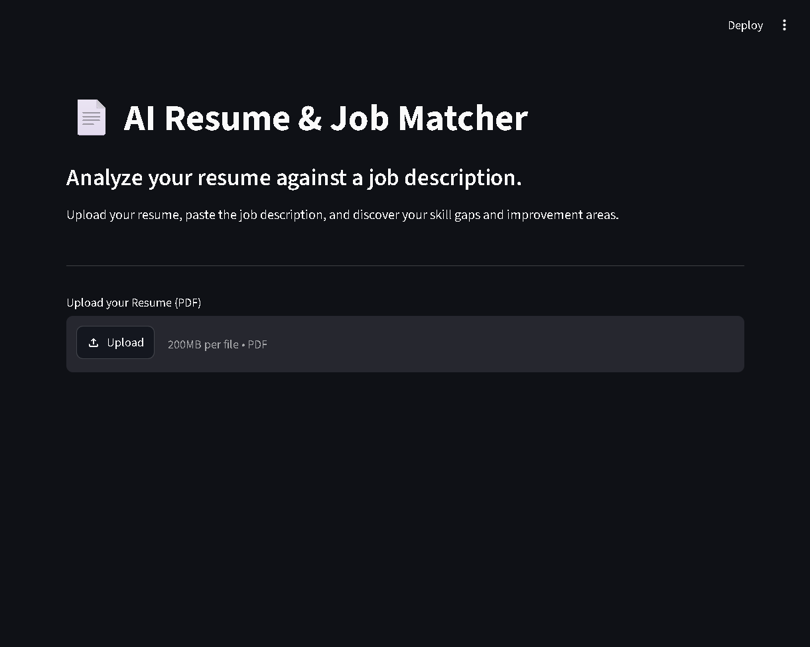
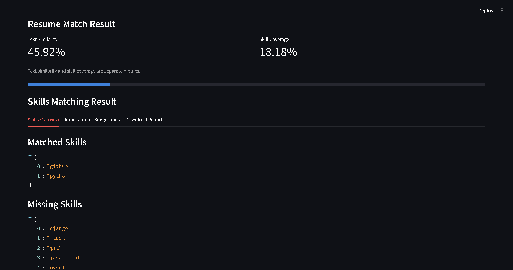
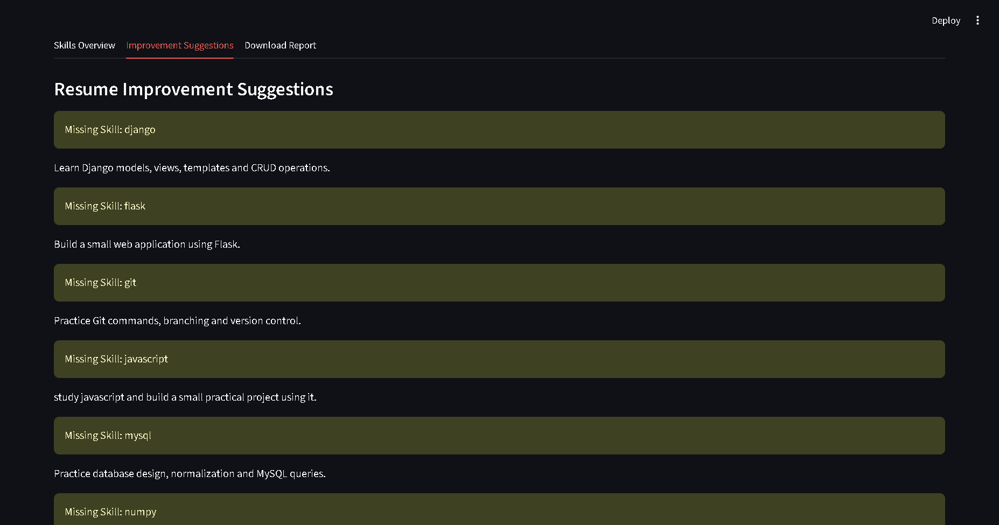
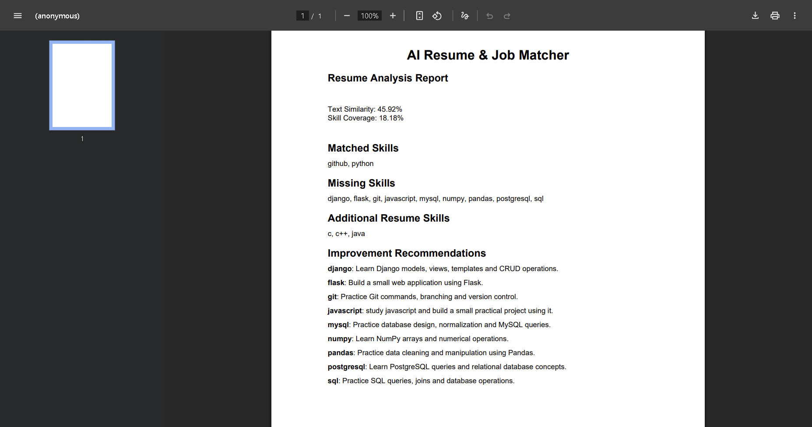

# AI Resume & Job Matcher

An AI-powered resume analysis application built with Python and Streamlit that compares a candidate's resume with a job description, identifies matching and missing skills, and generates improvement recommendations.

## Features

- **PDF Resume Extraction:** Extracts text from uploaded PDF resumes using PyPDF.
- **Text Preprocessing:** Cleans and tokenizes extracted resume text.
- **Skill Extraction:** Identifies technical skills using a predefined skill database and regular expressions.
- **Text Similarity:** Uses TF-IDF vectorization and cosine similarity to measure resume and job description similarity.
- **Skill Matching:** Identifies matched, missing, and additional resume skills.
- **Skill Coverage:** Calculates the percentage of required job skills found in the resume.
- **Improvement Recommendations:** Provides suggestions based on missing skills.
- **PDF Report Generation:** Generates a downloadable resume analysis report.

## Technologies Used

- Python
- Streamlit
- Scikit-learn
- Pandas
- PyPDF
- ReportLab
- Regular Expressions (Regex)
- Git and GitHub

## Project Structure

```text
AI-Resume-Job-Matcher/
│
├── app.py
├── text_preprocessing.py
├── skill_extractor.py
├── matcher.py
├── skill_matcher.py
├── recommendations.py
├── report_generator.py
├── requirements.txt
├── README.md
└── .gitignore
```

## Installation and Setup

### 1. Clone the repository

```bash
git clone https://github.com/avishgithub/AI-Resume-Job-Matcher.git
```

### 2. Navigate to the project directory

```bash
cd AI-Resume-Job-Matcher
```

### 3. Create a virtual environment

```bash
python -m venv venv
```

### 4. Activate the virtual environment

**Windows (Git Bash):**

```bash
source venv/Scripts/activate
```

**Windows (Command Prompt):**

```bash
venv\Scripts\activate
```

### 5. Install dependencies

```bash
pip install -r requirements.txt
```

### 6. Run the application

```bash
streamlit run app.py
```

The application will open in your browser.

## How to Use

1. Upload your resume in PDF format.
2. Review the extracted resume text and technical skills.
3. Paste the job description.
4. Click **Calculate Resume Match**.
5. Review text similarity and skill coverage.
6. Explore matched, missing, and additional skills.
7. Read personalized improvement suggestions.
8. Download the PDF analysis report.

## How Matching Works

### Text Similarity

The application uses TF-IDF (Term Frequency-Inverse Document Frequency) to convert text into numerical vectors and cosine similarity to calculate the similarity between the resume and job description.

### Skill Coverage

Skill coverage is calculated using:

```text
Skill Coverage =
(Matched Required Skills / Total Required Skills) * 100
```

### Skill Extraction

Technical skills are identified using a predefined skill database and regular-expression-based matching.

## Important Note

The text similarity score measures textual similarity, not the probability of getting hired or an assessment of a candidate's overall suitability. Skill coverage depends on the skills included in the application's predefined database.

## Future Improvements

- Expand the technical skill database.
- Improve skill alias recognition and normalization.
- Add more advanced NLP-based matching.
- Improve recommendation quality.
- Enhance the user interface and reporting features.

## Application Screenshots

### Dashboard


### Resume Analysis Results


### Improvement Suggestions


### Download PDF Report



## Author

**Avish Sharma**

GitHub: https://github.com/avishgithub
